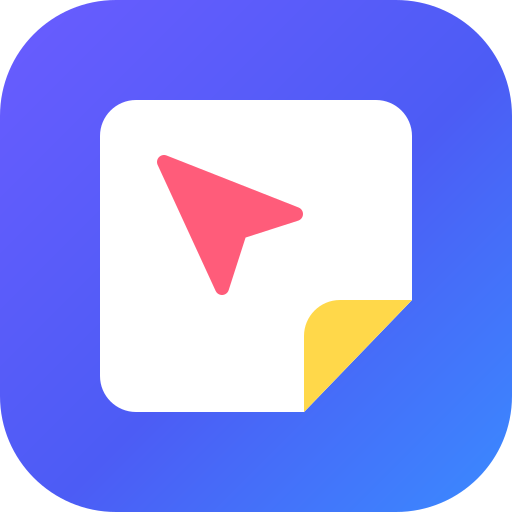

# グラボード (Graboard)

> 英字表記は **Graboard**。リポジトリ名・クレート名(`colabboard` / `board-*`)と、端末に保存済みのデータを引き継ぐための内部キー(`colabboard.*` など)は旧名のまま。

Miro や FigJam のように、Web 上で複数人が同時に編集できるホワイトボード。
クライアントもサーバーも **Pure Rust** で書き、描画は wgpu(WebGPU / WebGL2)で GPU に任せる。

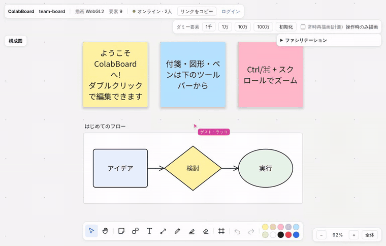

*A の画面。別のブラウザ(B)が付箋を貼って線を描くと、カーソルと名前つきでその場に現れる。*

## 強み

| 強み | 内容 |
| --- | --- |
| **全部 Rust、1 つの言語で完結** | ブラウザで動くクライアント(WASM)、描画エンジン、同期サーバー、データモデルまで Rust だけで書いている。データモデル(`board-core`)はクライアントとサーバーでそのまま共有するので、両者で解釈がずれない。 |
| **GPU で描くから要素が増えても軽い** | 1 要素 = 1 インスタンス(40 バイト)にまとめ、全要素を 1 回の描画命令で描く。画面外や 1px 未満の要素は GPU 側で捨てる。パン/ズームで GPU に送るのはカメラ情報 96 バイトだけで、ボードが変わったときも変わった範囲だけ送る。さらに描画順を保ったままブロック単位で画面外を捨て、ヒットテストや範囲選択は空間インデックスで画面付近だけを調べるので、100 万要素でもヒットテストは約 1.5 µs、等倍表示で GPU に渡すのは全体の 1% 未満。数字と再現手順は [docs/benchmarks.md](docs/benchmarks.md)(下の画像は 10 万要素)。 |
| **どの倍率でも輪郭がくっきり** | 角丸・枠線・影・楕円・星などの形はフラグメントシェーダの SDF(距離関数)で計算するので、拡大してもぼけない。文字も GPU で描画し、日本語 IME での入力に対応。 |
| **CRDT でぶつからない共同編集** | データは yrs(Yjs 互換の CRDT)で持つ。同じ要素を同時に触っても、通信の順番が前後しても、全員が同じ状態に収束する。**オフラインでも編集できる**: ボードは端末(IndexedDB)にも保存され、アプリ本体は Service Worker が持つので、サーバーにつながらなくても前回の内容から開いて編集でき、つながったら自動でマージされる。Undo/Redo は自分の操作だけを取り消す。 |
| **セルフホストが簡単** | サーバーは単一のバイナリで、組み込みデータベース(redb)にファイル 1 つで保存する。外部の DB やクラウドサービスは不要。ビルド済みクライアントの配信も同じサーバーがする。 |
| **会議でそのまま使える** | タイマー、付箋への投票、付箋の自動整理、AI による付箋の要約とグループ分け(任意)、プレゼン(全員の画面を自分の表示に追従させる)を内蔵。AWS 構成図の部品とサンプルも入っていて、自動レイアウトされた図から描き始められる。文章で説明すれば、生成 AI が構成図やフローチャートを作って置くこともできる(任意)。 |
| **アカウントと権限** | ログイン、ボードごとのメンバー招待(閲覧のみ / コメント可 / 編集可)、権限つき共有リンク。編集権限のない人の更新はサーバーが捨てる。 |
| **WebGPU がなくても動く** | WebGPU が使えないブラウザでは WebGL2 に自動で切り替える。 |

## スクリーンショット

**2 人で同じボードを編集**。左が A、右が B の画面。それぞれの画面に相手のカーソルと名前が見え、B が貼った付箋と手書き線は A の画面にも出ている。

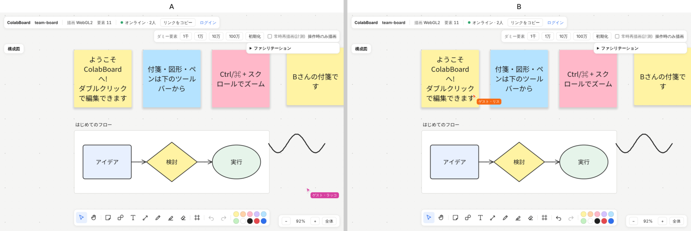

**AWS 構成図のサンプル**。「構成図」→「AWS: Web 3 層構成」で、枠(AWS Cloud / Region / VPC / サブネット)とサービスが自動で並び、矢印でつながった状態で入る。

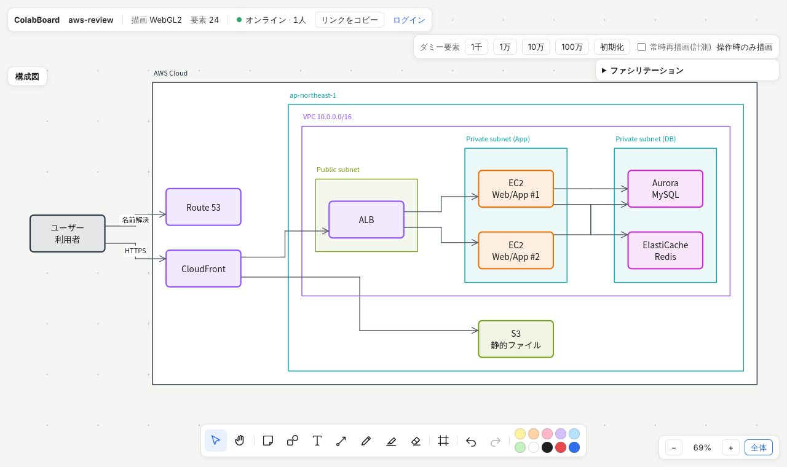

**UML クラス図と ER 図のテンプレート**。継承(白三角)・実現(破線)・コンポジション(黒ひし形)・依存や、ER のカラスの足は、コネクタの書式バーで選べる。

| UML クラス図 | ER 図 |
| --- | --- |
| 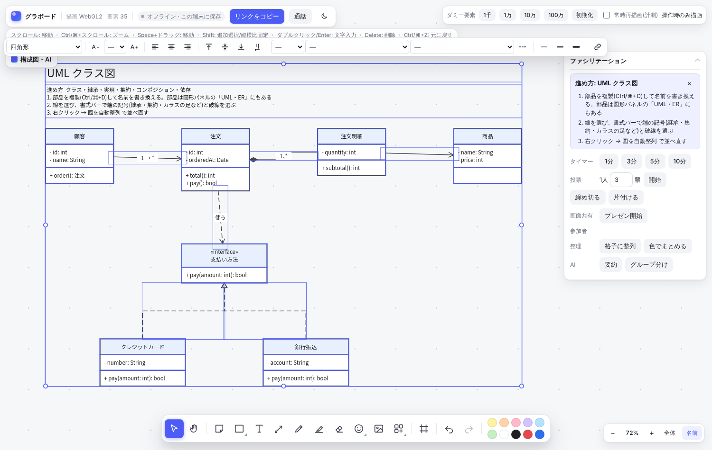 | 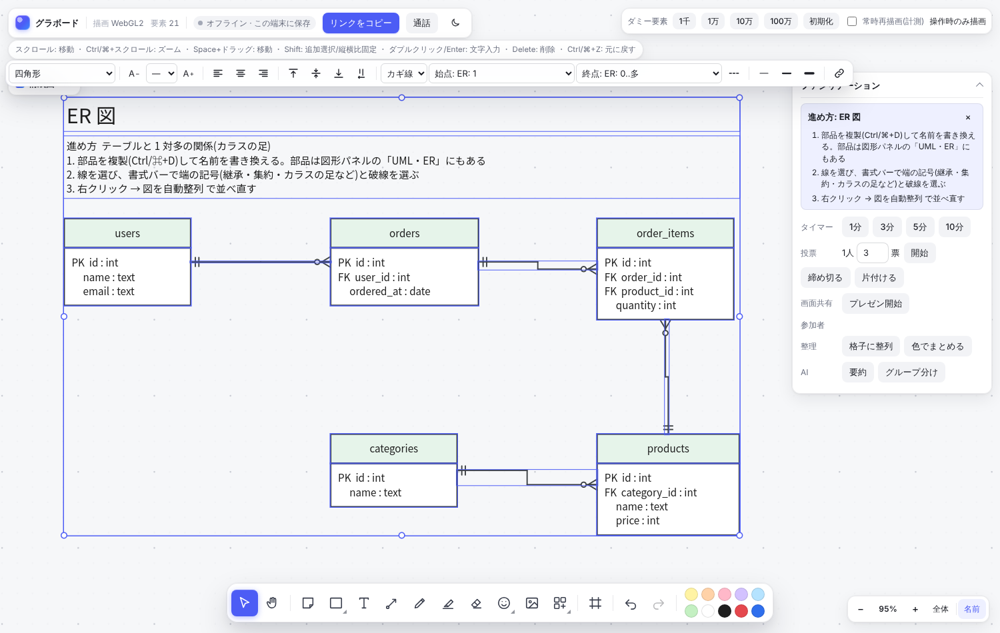 |

**スマートガイド**。動かしている図形が周りの図形の上端・中心・下端にそろい、間隔も等しくなる位置で赤いガイドが出る。

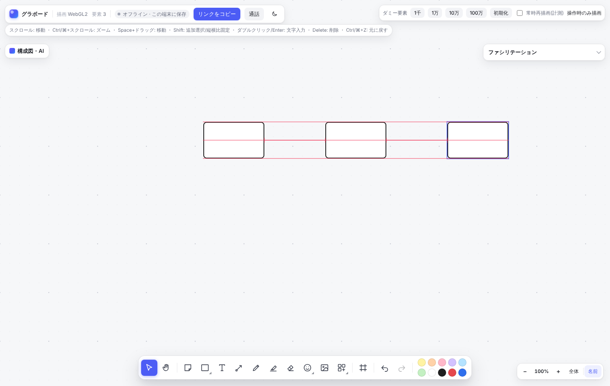

**マインドマップ**。Tab と Enter だけで枝を伸ばすと、左右に振り分けて自動で並ぶ。枝ごとに色が分かれる。

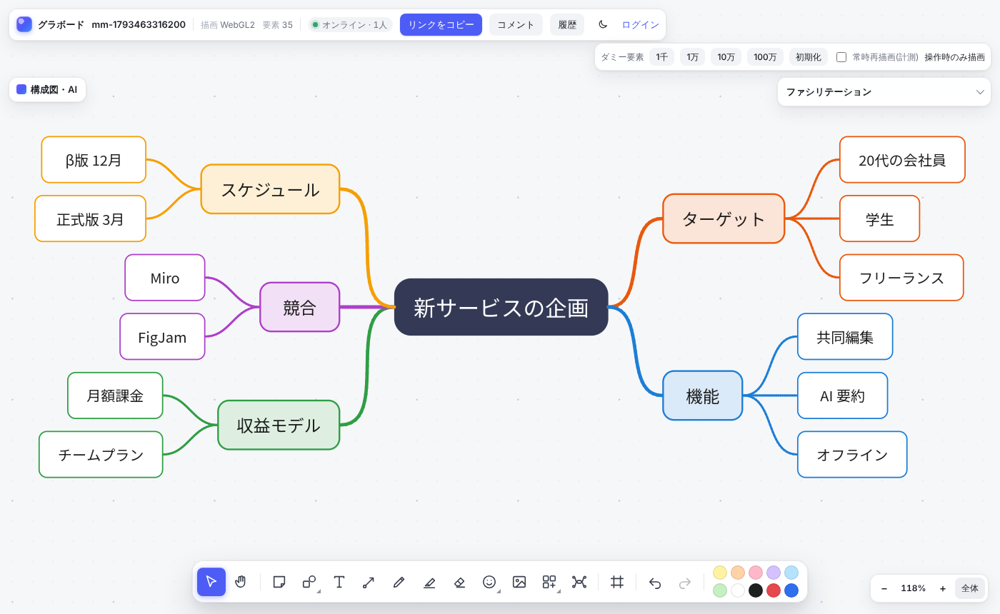

**10 万要素のボード**(`?n=100000`)。全体表示(左)からズームしても(右)、付箋・図形の輪郭はくっきりしたまま。

| 全体表示(2%) | ズーム(24%) |
| --- | --- |
| 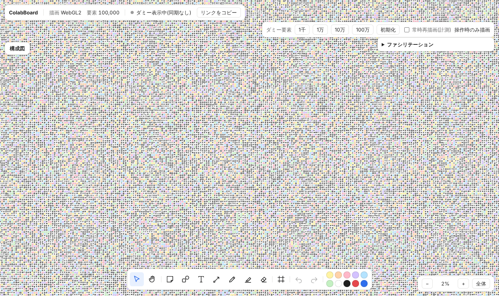 | 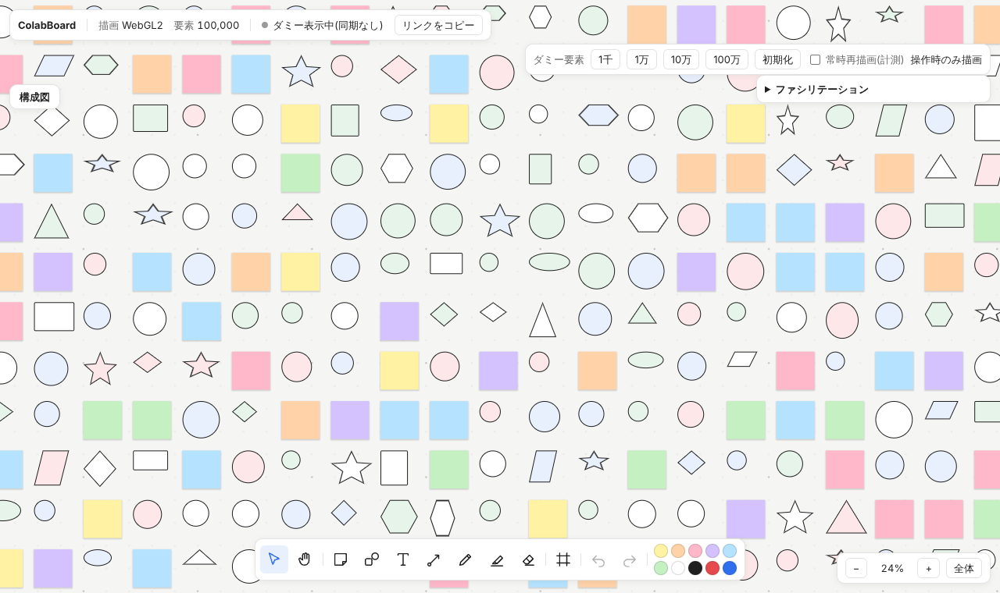 |

**パン・ズームの操作**(1 千要素)。全体表示から寄って、パンして、引くまで。

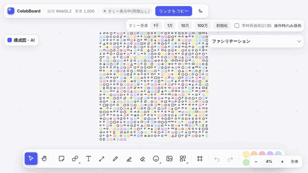

*この GIF は GPU のないクラウド環境(ソフトウェア描画)で撮ったもので、実機より動きが重い。10 万要素で実機の動きを撮るには、下の「10 万要素をパン・ズームする GIF を撮る」を使う。*

## できること

### キャンバスと編集

| 機能 | 内容 |
| --- | --- |
| **無限キャンバス** | 無限キャンバスのパン/ズーム(スクロール、Space+ドラッグ、Ctrl/⌘+スクロール、トラックパッド/タッチのピンチ) |
| **作れるもの** | 付箋、図形(四角形・楕円・三角形・ひし形・星・六角形・平行四辺形)、テキスト、コネクタ(要素どうしをつなぐ矢印。相手を動かすと経路が付いてくる)、ペン、蛍光ペン、消しゴム、フレームの作成 |
| **選択と変形** | 選択(クリック、Shift で追加、範囲選択)、移動、8 方向リサイズ(Shift で縦横比固定)、削除、色変更 |
| **スマートガイドとスナップ** | 動かしたりリサイズしたりすると、周りの図形の端・中心にそろう位置や、隣との間隔が等しくなる位置に吸い付き、赤いガイド線が出る(Alt / Option を押している間は吸い付かない) |
| **編集メニュー** | コピー&ペースト・複製・グループ化・整列/等間隔・重なり順・ロック(右クリックメニューとショートカット) |
| **文字入力** | 付箋・図形への文字入力(ダブルクリック / Enter、日本語 IME 対応) |
| **Undo / Redo** | Undo / Redo(自分の操作だけを取り消す。ドラッグ 1 回 = 1 単位) |

### 図を描く

| 機能 | 内容 |
| --- | --- |
| **UML・ER の部品** | 図形パネルの「UML・ER」から、クラス・インターフェース・エンティティ(ER)・ライフライン・活性区間・複合フラグメント(alt / loop)・アクター・ユースケース・状態・開始/終了状態・ノートを置ける(押すと画面の中央、ドラッグでその場所)。クラスやエンティティは区画をまとめたグループなので、ふつうの図形と同じように文字を書き換えて使う |
| **UML・ER 図の線** | コネクタを選ぶと書式バーで始点・終点の記号(矢印、白三角=継承、黒三角、白ひし形=集約、黒ひし形=コンポジション、丸、ER のカラスの足 1 / 多 / 0..1 / 1..多 / 0..多)と破線を選べる |
| **図の自動整列** | コネクタでつないだ図形を 1 つ(または複数)選んで、右クリックの「図を自動整列」か「構成図・AI」パネルのボタンを押すと、矢印の向きに沿って段に並べ直す(左から右 / 上から下)。線の交差が少なくなる順に並べ、つながっていない固まりは別に積む。1 回の Undo で戻せる |
| **マインドマップ** | ツールバーのマインドマップのボタンで中心のノードを置き、Tab で子、Enter で兄弟を足していく(文字の編集中も Tab で確定して子へ)。矢印キーで隣のノードへ移動、`/` で枝の折りたたみ、Delete で枝ごと削除。並べ方は左右・右へ・放射から選べ、自動で並び直す。枝は曲線で、中心から出る枝ごとに色が分かれる。ノードを別のノードの上へドラッグするとその子に付け替わる。共同編集で同時に枝を足しても全員の配置がそろう |
| **構成図** | 左上の「構成図」から AWS(約 70 種)・Azure(約 40 種)・Google Cloud(約 35 種)のサービスと、AWS Cloud / Region / VPC / AZ / サブネット、Azure のサブスクリプション / リソース グループ / VNet、Google Cloud のプロジェクト / VPC などの枠を置ける。サンプル(AWS の Web 3 層・サーバーレス、Azure の Web アプリ、Google Cloud のコンテナ API、フローチャート)は自動レイアウトして矢印でつないだ状態で挿入される。各社の公式アイコンは下の「クラウドの公式アイコン」で取り込める |
| **手書きを図形に整形** | ペンで描いた線を選ぶと書式バーに「図形に整形」と「AI で整形」が出る。「図形に整形」は端末だけで四角・丸・三角・ひし形・五角形・六角形・星・線・矢印(矢じりを別に描いても可)を認識し、線の端を近くの図形につなぐ。「AI で整形」(サーバーに `ANTHROPIC_API_KEY` を設定したとき)は線を画像にして Claude に読ませ、雲や円柱などの図形と手書きの文字も整える(図形の中の文字はその図形の文字になる)。読めなかった線はそのまま残り、1 回の Undo で戻せる |

### 共同編集・保存・共有

| 機能 | 内容 |
| --- | --- |
| **リアルタイム共同編集** | 同じ URL(`?room=…`)を開いた人どうしで編集が即座に反映され、相手のカーソルと名前が見える。「リンクをコピー」で招待 |
| **サーバーで保存** | サーバーで保存(redb)。再起動してもボードが残る |
| **オフライン編集** | ボードはこの端末(IndexedDB)にも保存され、アプリ本体は Service Worker が持つ。サーバーにつながらなくても前回の内容から開いて編集でき、つながると自動でマージされる(HUD に「オフライン · この端末に保存」と出る) |
| **ログインとボード一覧** | トップページでアカウントを作ってログインすると、自分のボード(作った・招待された・開いた)が並ぶ。ボード名はクリックで変更 |
| **ボードを探す** | ボード一覧の上の検索欄(`/` で移動)で、開けるボードすべてを名前・タグ・フォルダ・中身の文字(付箋・図形・表・コネクタのラベル)から探せる。語を空白で区切るとすべてを含むボード、`#企画` のように `#` を付けるとタグだけを見る。大文字と小文字・全角と半角・ひらがなとカタカナは区別しない。中身で見つかった箇所を押すと、ボードを開いてその要素へ移動する。ボードには自分だけのお気に入り(☆)・タグ・フォルダを付けられ、「★ お気に入り」やフォルダで絞り込める(フォルダは名前の変更・解除も可)。最近開いたボードは一覧の上にカードで並ぶ |
| **共有** | オーナーは「共有」から、ログイン名での招待と共有リンク(閲覧のみ / コメント可 / 編集可)を設定できる。権限のない人には「開けません」と表示し、閲覧のみの人には編集の道具を出さない |
| **Web に公開** | 「共有」の「Web に公開」をオンにすると、ログインしていない人も見られる閲覧専用のページ(`/p/{ボード}/{鍵}`)ができる。SNS やチャットに貼るとボード名・内容の要約・ボードの縮小画像(OGP)が出る。公開ページを開くと編集の道具を隠したボードが表示され、スライド表示もできる。オフにするか URL を作り直すと古い URL は使えなくなる |
| **他のサイトへの埋め込み** | オーナーは「共有」パネルの「他のサイトに埋め込む」で権限(閲覧のみ / コメント可 / 編集可)を選ぶと、iframe のコードをコピーできる。埋め込み用の鍵は共有リンクとは別で、止めたり作り直したりできる。埋め込み表示(`&embed=1`)ではボード以外の飾りを隠し、右上に「グラボードで開く」を出す。埋め込みを許すサイトは `EMBED_ALLOWED_ORIGINS` で絞れる(それ以外のページは同じサイトからしか iframe に入れられない) |
| **コメントとメンション** | 「コメント」→「＋ 追加」でボード上(図形の上なら図形に付いていく)にコメントを置き、スレッドで返信・解決できる。`@ログイン名` でメンションすると相手のベルに通知が届く(返信もスレッドの参加者に通知)。コメントは「コメント可」以上の権限でログインした人が書ける |
| **バージョン履歴** | 編集すると 10 分ごと(と全員が抜けたとき)に自動で保存され、「履歴」から名前を付けて保存もできる。昔のバージョンを選ぶとその状態を表示し(同期は続く)、「このバージョンに戻す」で全員のボードを戻せる。戻す前の状態も履歴に残る |

### 会議・ワークショップ

| 機能 | 内容 |
| --- | --- |
| **ファシリテーション**(右上のパネル) | 全員に見えるタイマー(一時停止・延長、終了時に音)、付箋への投票(1 人あたりの票数を決めて開始 → 締め切ると結果と順位を表示)、付箋の自動整理(格子に整列・色でまとめる)、プレゼン(「プレゼン開始」で全員の画面が自分の表示に追従。参加者の名前を押すとその人をフォロー、自分で動かすと解除) |
| **スライド表示**(ヘッダーの「スライド」) | フレームを 1 枚ずつ全画面で見せる。並びは読む順(上の段から、同じ段は左から)で、フレーム名が全部数字で始まっていれば(「1. はじめに」など)その番号順。`←` `→` / Space / クリックで移動し、切り替えはカメラが滑らかに動く。周りは暗くなり、操作バーはマウスを止めると隠れる。共同編集中は自動でプレゼンになり、参加者の画面もスライドに追従する |
| **テンプレート**(ツールバーのテンプレートボタン) | 振り返り・ワークショップ・戦略・計画・図解(UML・ER)の 59 種を、分類と検索から選べる。振り返りは KPT・YWT・4L・Start/Stop/Continue・Mad/Sad/Glad・スターフィッシュ・DAKI・KALM・帆船・熱気球・タイムライン・ESVP など、ワークショップは Crazy 8s・How Might We・1-2-4-全体・リーンコーヒー・6 つの帽子・なぜなぜ分析・共感マップ・ペルソナなど、戦略・計画はリーンキャンバス・ビジネスモデルキャンバス・SWOT・PEST・プレモーテム・OKR・ストーリーマップ・MoSCoW など。図解は UML クラス図・ER 図・シーケンス図・ユースケース図・状態遷移図・アクティビティ図。置くとボードに見出しと進め方が入り、ファシリテーションのパネルに手順ごとのボタン(タイマー・投票開始・締め切り・AI でまとめる/要約)が出る。どれも普通の付箋・フレーム・表でできているので自由に編集できる |
| **ワークショップの進行**(ファシリテーションのパネル) | 「自分のエリアを作る」で個人作業エリア(フレーム)を作ると、中に置いた付箋はほかの人には中身のない「作業中」のカードに見え、選択・編集・検索・書き出し・AI の対象にもならない。外へ出すか「公開」すると全員に見える(データは全員に同期されるので、画面上の目隠しとして使う)。「匿名」をオンにすると全員の画面でほかの人のカーソルが灰色になり名前が消える。「小部屋」で部屋数を決めて「分かれる」と、部屋(フレーム)ができて参加者が人の少ない部屋へ自動で振り分けられ、各自の画面が自分の部屋へ移る(部屋の外の人のカーソルは出ない。「移る」で部屋を変えられ、「全員を戻す」で終わる) |
| **音声通話** | 上の「通話」でボードを開いたまま参加者と話せる。ミュート、話している人の表示(左下のバーとカーソルの名札)付き。誰かが通話中だとボタンに人数が出る。音声は参加者どうしで直接やり取りし(WebRTC の P2P メッシュ、8 人まで)、サーバーは接続手順を中継するだけ。マイクを使うので HTTPS か localhost で開く |
| **動画メモ**(ツールバーのカメラのボタン) | カメラとマイクで最長 1 分の動画を録り、確認・撮り直しをしてからボードに置ける。表紙(最初のコマに再生ボタンと長さ)がボードに同期され、ダブルクリック(選択して Enter)でその場で再生する。動画はサーバーに保存し(ボードを消すと一緒に消える)、ボードを開ける人だけが見られる |

### AI

| 機能 | 内容 |
| --- | --- |
| **AI**(サーバーに `ANTHROPIC_API_KEY` を設定したとき) | 付箋の要約(結果を新しい付箋に)と、内容の近い付箋のグループ分け(グループごとに並べ直してフレームと見出しを付ける)。選択中の付箋、なければ全付箋が対象で、1 回の Undo で戻せる。「マインドマップ」は内容を論点ごとの枝に整理し、マインドマップモードと同じ形で横に置く(そのまま Tab / Enter で枝を足せる)。ファシリテーションのパネルの「議事録」は、選択中の要素(なければボード全体)から概要・話し合ったこと・決定事項・アクション(表)・未解決の課題をまとめ、ボードの右側にフレームと付箋で置く。その下の欄からはボードについて質問でき、答えと根拠の要素が出る(根拠を押すとその場所へ移動。続けて質問すると前のやり取りを踏まえる) |
| **生成 AI で図を作る**(サーバーに `ANTHROPIC_API_KEY` を設定したとき) | 「構成図・AI」パネルに作りたい構成や手順を書くと、Claude が AWS・Azure・Google Cloud の構成図やフローチャートを作り、自動レイアウトしてボードに置く。1 回の Undo で戻せる |

### 外部サービスとの連携

| 機能 | 内容 |
| --- | --- |
| **Slack 通知** | オーナーは「共有」パネルで Slack の Incoming Webhook URL を登録すると、コメント・メンション・名前を付けたバージョンの保存(と復元)をチャンネルに流せる。送る出来事は選べて、「テスト送信」で届くか確かめられる。URL は保存後は末尾しか表示しない |
| **GitHub・Jira の課題カード** | 課題やプルリクエストの URL(`https://github.com/…/issues/12`、`…/pull/34`、`https://…atlassian.net/browse/PROJ-5`)を貼ると、番号・タイトル・状態・担当者を書いたカードになる(複数行まとめて貼れる)。色は状態ごと(オープン=緑、進行中=青、完了・マージ=紫、対応しないで閉じた=灰)。ボードを開いている間は 2 分ごとに状態を引き直して全員のカードを書き換える。クリックで課題を開く |

### 性能確認・動作環境

| 機能 | 内容 |
| --- | --- |
| **性能確認** | ダミー要素 1 千〜100 万個での性能確認(右上のボタン、または `?n=100000`)。`?bench` で決まった手順のパン/ズームを自動で計測([docs/benchmarks.md](docs/benchmarks.md)) |
| **WebGL2 への切り替え** | WebGPU が使えないブラウザでは WebGL2 に自動で切り替え(`?webgl` で強制) |

## はじめかた

必要なもの: Rust(1.88 以上)、[trunk](https://trunkrs.dev/)

```sh
rustup target add wasm32-unknown-unknown
cargo install trunk --locked

# 1. Web クライアントをビルド
(cd crates/board-web && trunk build --release)
# 2. 同期サーバーを起動(ビルド済みクライアントも配信する)
cargo run -p board-server --release
# → http://localhost:8080 を開く
```

サーバーなしで試すだけなら、`cd crates/board-web && trunk serve` で開いたページがそのタブだけで動く(サーバーが見つからないと自動でオフラインになる)。
クライアントを編集しながら開発するときは、サーバーを起動したまま `trunk serve` を使う(`/ws` はサーバーへ中継される)。

### クラウドの公式アイコン

AWS・Azure・Google Cloud の公式アイコンは構成図を描くために提供されていますが、ソースコードと一緒に再配布する許可はないため、リポジトリには含めていません。
次のスクリプトで公式サイトから ZIP をダウンロードし、`crates/board-web/assets/cloud-icons/` に取り込みます(その後 `trunk build` でクライアントに含まれます)。

```sh
tools/fetch-cloud-icons.sh                    # 3 社ともダウンロード
tools/fetch-cloud-icons.sh --aws ~/Downloads/Icon-package.zip   # 手元の ZIP を使う
```

配布 URL が変わってダウンロードに失敗したときは、[AWS](https://aws.amazon.com/architecture/icons/)・[Azure](https://learn.microsoft.com/azure/architecture/icons/)・[Google Cloud](https://cloud.google.com/icons) のページから ZIP を取得して `--aws` / `--azure` / `--gcp` で渡してください。取り込むと、構成図の部品は左側に、枠は左上の角に公式アイコンが付きます(アイコンは各自のブラウザで描くので、ボードのデータには種類の名前だけが入ります)。取り込んでいない部品は色付きの図形で表示されます。

## 使い方

| 手順 | やること |
| --- | --- |
| 1 | `http://localhost:8080` を開くとトップページが出る。「アカウントを作る」でログインすると自分のボード一覧になり、名前を入れて「ボードを作る」。ログインせずに試すなら「ログインせずに新しいボードを作る」(URL を知っている人なら誰でも編集できるボードになる)。新しいボードには使い方の付箋と流れ図のサンプルが置いてある。 |
| 2 | 下のツールバーで道具を選ぶ。付箋(`S`)や図形(`R` / `O`、ほかの形はボタンから)はクリックかドラッグで置き、ペン(`P`)・蛍光ペン(`M`)はドラッグで描く。コネクタ(`X`)は要素から要素へドラッグすると矢印でつながる。 |
| 3 | 置いた付箋や図形をダブルクリック(または選んで `Enter`)すると文字を入力できる。`Esc` か外側のクリックで確定。 |
| 4 | 選択ツール(`V`)で要素をクリック / 範囲選択し、ドラッグで移動、四隅と辺のハンドルでリサイズ。色はツールバー右の色から選ぶ。 |
| 5 | 相手を招く。ログインして作ったボードは上の「共有」から、ログイン名での招待か共有リンク(閲覧のみ / コメント可 / 編集可)を設定する。ログインなしのボードは「リンクをコピー」で URL を送ればよい。同じボードを開いた人のカーソルは名前つきで表示される。 |
| 6 | 会議では右上の「ファシリテーション」からタイマー・投票・プレゼンを使う。図を描くときは左上の「構成図・AI」から部品やサンプルを置くか、文章で説明して生成 AI に作らせる。 |
| 7 | 間違えたら `Ctrl/⌘ + Z`。自分の操作だけが戻り、相手の編集は消えない。 |

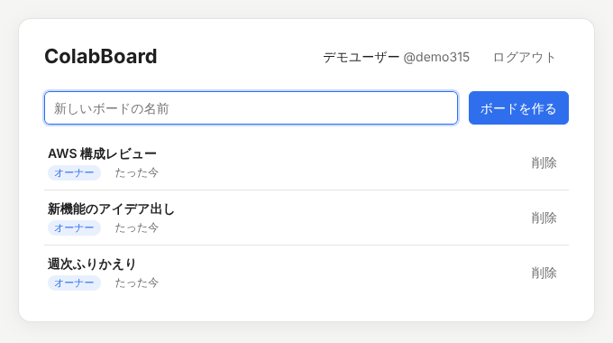

### 操作一覧

| 操作 | 動作 |
| --- | --- |
| `V` `H` `S` | 選択 / 手のひら / 付箋 |
| `R` `O` `T` `X` | 四角形 / 楕円 / テキスト / コネクタ |
| `P` `M` `E` `F` | ペン / 蛍光ペン / 消しゴム / フレーム |
| スクロール、Space+ドラッグ、中ボタンドラッグ | 移動 |
| Ctrl/⌘ + スクロール、ピンチ | カーソル位置を中心にズーム |
| Shift + クリック / ドラッグ | 追加選択 / 縦横比を保って変形・作成 |
| Alt / Option + ドラッグ | スナップせずに移動・リサイズ |
| Alt + Shift + L / J | 選んだ図を自動整列(左から右 / 上から下) |
| ダブルクリック / `Enter` | 文字を入力(`Esc` か `Ctrl/⌘+Enter`、または外側クリックで確定) |
| `Delete` / `Backspace` | 選択中の要素を削除 |
| `Ctrl/⌘ + Z` / `Ctrl/⌘ + Shift + Z`(`Ctrl + Y`) | 元に戻す / やり直す |
| `Ctrl/⌘ + A` / `Esc` | すべて選択 / 選択解除 |
| `+` / `-` / `1` / `0` | ズーム / 全体表示 / 100% |
| 右クリック | コピー・貼り付け・複製・グループ・整列・重なり順・ロックなどのメニュー |
| `Ctrl/⌘ + X` / `C` / `V` / `D` | 切り取り / コピー / 貼り付け / 複製 |
| `Ctrl/⌘ + G` / `Ctrl/⌘ + Shift + G` | グループ化 / 解除 |
| `Ctrl/⌘ + ]` `[`(Shift で最前面 / 最背面) | 重なり順を 1 つ前へ / 後ろへ |
| `Ctrl/⌘ + Shift + L` | ロック / 解除 |
| `Alt` + `A` `H` `D` / `W` `V` `S` | 左 / 左右中央 / 右、上 / 上下中央 / 下にそろえる |
| スライド中: `→` `↓` Space `Enter` / `←` `↑` / `Home` `End` / `Esc` | 次へ / 前へ / 最初・最後 / 終了(クリックでも次へ、画面の左端なら前へ) |

### キーボードだけで使う・画面読み上げ

マウスなしでもボードを作れます。キャンバスにフォーカスして(`Tab`)、次のキーを使います。`?` で一覧を表示します。

| キー | 操作 |
| --- | --- |
| `Tab` / `Shift + Tab` | 要素を読む順(上の行から下へ、行の中は左から右へ)に選ぶ。端まで来るとキャンバスの外へ出る |
| `Alt + 矢印` | その方向で一番近い要素へ移る |
| 矢印(`Shift` で 10 倍) | 選んだ要素を動かす。何も選んでいなければ画面を動かす |
| `Alt + Shift + 矢印` | その方向の要素とコネクタでつなぐ。相手がなければ同じ種類の要素を置いてつなぐ |
| `S` `R` `O` `T` `F` → `Enter` | 付箋・四角形・楕円・テキスト・フレームを画面の中央(選択中ならその右)に置いて文字入力 |
| `Enter` / `F2` | 選んだ要素の文字を入力(`Esc` で確定してキャンバスに戻る) |
| `Shift + F10` / メニューキー | 右クリックメニューを開く(上下キーで選び、`Esc` で閉じる) |

画面読み上げ(NVDA・VoiceOver など)には、選んだ要素の説明(種類・文字・つながりの数・何番目か)とツールの切り替えを読み上げで知らせます。キャンバスの中身は見出し「ボードの要素」の不可視の一覧にも出しているので、読み上げの一覧から要素を選べます(要素が 300 個を超えるボードでは画面に見えている分だけ)。OS の「視差効果を減らす」「コントラストを上げる」の設定にも合わせます。

### スマホ・タブレット

iOS Safari・Android Chrome で動く(WebGPU がなければ WebGL2 で描く)。画面が狭いとツールバーは横にスクロールでき、パネルは画面幅に広がる。

| 操作 | 動作 |
| --- | --- |
| タップ / ドラッグ | 選択 / 移動・変形(選択ツールで何もない所をなぞると画面を移動、タップで選択解除) |
| 2 本指ドラッグ / ピンチ | 画面を移動 / ズーム |
| 長押し | 右クリックと同じメニュー |
| ダブルタップ | 文字を入力(キーボードで隠れないよう画面が動く) |
| ペン(Apple Pencil など) | ペンが触れている間の指は無視。ペンを使い始めたら、ペン・蛍光ペン・消しゴムでは指で画面を移動 |
| `Alt + Shift + H` / `V` / `T` | 横 / 縦に等間隔、格子に整頓 |

### URL パラメータ

| URL パラメータ | 内容 |
| --- | --- |
| `?room=名前` | 参加するボード(英数字・`-`・`_`)。なければボード一覧(API のないサーバーでは新しいボードを作る) |
| `&key=…` | 共有リンクの鍵(Web に公開したページの鍵も同じ) |
| `&public` | 公開ページから開いた表示(編集用の UI を隠し、カーソルを送らない) |
| `?offline` | サーバーにつながず、このタブだけで動かす(保存しない) |
| `?nosw` | Service Worker を登録しない(開発中にキャッシュを避けたいとき) |
| `?server=ws://host:port` | 別ホストの同期サーバーにつなぐ |
| `?n=100000` | 性能確認用のダミーボード(同期しない) |
| `?bench` | 計測モード。決まった手順で動かし、結果を HUD と `window.__benchResult` に出す |
| `?nocull` | ブロック単位のカリングを切る(効果の比較用) |
| `?webgl` | WebGL2 を強制 |

## セルフホスト

詳しい手順(Docker / systemd / リバースプロキシ / バックアップ)は [docs/self-hosting.md](docs/self-hosting.md)。

```sh
docker compose up -d          # → http://localhost:8080(データは colabboard-data ボリューム)
```

Docker を使わない場合は、クライアントを埋め込んだ単一バイナリにできる。ファイル 1 つをコピーするだけで動き、データは `DATA_DIR/boards.redb` の 1 ファイルに保存される。

```sh
(cd crates/board-web && trunk build --release)
cargo build -p board-server --release --features embed
DATA_DIR=/var/lib/graboard PORT=8080 ./target/release/board-server
./target/release/board-server healthcheck   # 死活監視(/healthz を確かめ、終了コードで返す)
```

`embed` なしでビルドした場合は `STATIC_DIR` でクライアントのディレクトリを指定する。

PDF の取り込み(hayro、約 3 MB)は別の wasm(`board-pdf_bg.wasm`)に分けてあり、PDF が貼られたときに Web Worker で初めて読み込む。初回表示の重さには入らない。

HTTPS で公開するときは前段にリバースプロキシ(WebSocket の `/ws` も通す)を置き、`COOKIE_SECURE=1` と `TRUST_PROXY=1` にする。
ログイン試行の回数制限、アカウント数・ボード数・接続数の上限、CSP などのセキュリティヘッダーも組み込み済み。設定とチェックリストは [docs/self-hosting.md の「公開前の守り」](docs/self-hosting.md#公開前の守り)。

| 環境変数 | 既定値 | 内容 |
| --- | --- | --- |
| `PORT` | `8080` | 待ち受けポート |
| `DATA_DIR` | `data` | 保存先(`boards.redb`)。空にすると保存しない |
| `STATIC_DIR` | `crates/board-web/dist` | 配信するクライアント。`embed` 版で埋め込みを使うなら指定しない |
| `MAX_MESSAGE_MB` | `128` | WebSocket で受け取る 1 通の上限。数十万要素のボードを使うなら増やす |
| `RUST_LOG` | `info` | ログの詳しさ |
| `ANONYMOUS_BOARDS` | `1` | `0` にするとログインなしのボード(`?room=` で誰でも作れて誰でも編集できるもの)を禁止 |
| `COOKIE_SECURE` | `0` | HTTPS で公開するときは `1`(ログイン Cookie に `Secure` を付ける) |
| `TRUST_PROXY` | `0` | リバースプロキシの後ろでは `1`(`X-Forwarded-For` から利用者の IP を取り、回数制限に使う) |
| `MAX_USERS` / `MAX_BOARDS_PER_USER` | なし / `500` | アカウント数と、1 人が持てるボード数の上限。ほかの上限は docs/self-hosting.md |
| `ANTHROPIC_API_KEY` | なし | 設定すると AI 機能(付箋の要約・グループ分け、文章からの図の生成、手書きの整形、議事録、質問応答)が使える。使えるのはボードの編集権限がある人だけ |
| `ANTHROPIC_MODEL` | `claude-opus-5-5` | AI 機能で使う Claude のモデル |
| `PUBLIC_URL` | なし | 公開している URL(例 `https://board.example.com/`)。Slack 通知にボードへのリンクを付ける |
| `GITHUB_TOKEN` | なし | 課題カードで GitHub を引くときのトークン(非公開リポジトリ用。なくても公開リポジトリは読める) |
| `GITHUB_API_URL` | `https://api.github.com` | GitHub Enterprise などの API の場所 |
| `JIRA_BASE_URL` | なし | 課題カードで引く Jira のサイト(`https://example.atlassian.net`)。これ以外のサイトの URL は引かない |
| `JIRA_EMAIL` / `JIRA_API_TOKEN` | なし | Jira の API トークン(3 つそろうと Jira 連携が有効になる) |
| `JIRA_API_URL` | `JIRA_BASE_URL` | Jira の API を別の場所(プロキシなど)経由で呼ぶとき |
| `EMBED_ALLOWED_ORIGINS` | `*` | ボードを iframe で埋め込んでよいサイト(空白区切り。例 `https://wiki.example.com https://*.example.org`) |
| `SLACK_WEBHOOK_PREFIXES` | `https://hooks.slack.com/` | Slack 通知を送ってよい Webhook URL の先頭(カンマ区切り)。これ以外の URL は登録できない |
| `PLUGIN_DIR` | なし | ここにある `*.wasm` をサーバーのプラグインとして読み込む(全員が使える) |
| `USER_PLUGINS` | `1` | `0` にすると各自がプラグインを入れるのを禁止(サーバーのプラグインだけになる) |
| `ADMIN_LOGINS` | なし | サーバー管理者のログイン名(カンマ区切り)。全体の操作ログを見られ、チームの SSO 自動参加ドメインを設定できる |
| `TRUST_PROXY` | `0` | `1` でリバースプロキシの `X-Forwarded-For` の先頭を操作ログの接続元にする |
| `AUDIT_RETENTION_DAYS` | `365` | 操作ログを残す日数 |
| `OIDC_ISSUER` / `OIDC_CLIENT_ID` / `OIDC_CLIENT_SECRET` / `OIDC_REDIRECT_URL` | なし | 4 つそろうと OpenID Connect の SSO が有効になる。コールバックは `https://…/api/sso/oidc/callback` |
| `OIDC_NAME` / `OIDC_SCOPES` | `SSO` / `openid email profile` | ログイン画面のボタンの名前と、IdP に求めるスコープ |
| `OIDC_ALLOWED_DOMAINS` | なし | SSO でログインできるメールのドメイン(カンマ区切り。確認済みのメールだけ) |
| `PASSWORD_LOGIN` | `1` | `0` でパスワードのログインとアカウント作成を止める(SSO だけにする) |
| `STORAGE_LOCATIONS` | なし | チームが選べるデータの保存場所(下の「組織で使う」を参照) |
| `ICE_SERVERS` | Google の公開 STUN | 音声通話の STUN / TURN サーバー(`RTCIceServer` の JSON 配列)。会社のネットワーク越しなど直接つながらない相手と話すなら TURN を足す。例: `[{"urls":"turn:turn.example.com:3478","username":"u","credential":"p"}]` |

### アカウントと権限

| 項目 | 内容 |
| --- | --- |
| **ログイン** | `/api/signup` `/api/login` でアカウントを作ってログインする(パスワードは Argon2id で保存、セッションは `HttpOnly` Cookie)。 |
| **オーナーと共有** | ログインして作ったボードにはオーナーがいて、最初は本人しか開けない。共有は 2 通り。 |
| **メンバー招待** | ログイン名を指定して「閲覧のみ / コメント可 / 編集可」を与える。 |
| **共有リンク** | `?room=…&key=…` のリンクを開いた人に、決めた権限を与える。作り直すと古いリンクは使えなくなる。 |
| **Web に公開** | `/p/{ボード}/{鍵}` で誰でも閲覧のみで見られる。このページはサーバーが OGP の `<meta>` を入れた HTML を返し(クローラー向け)、ブラウザではすぐ閲覧用のボードへ移る。OGP 画像(`/p/{ボード}/{鍵}/og.png`、1200×630)はサーバーが CPU でボードを縮小して描き、ボード名を Noto Sans JP で入れる(1 分キャッシュ)。逆プロキシの裏では `X-Forwarded-Host` / `X-Forwarded-Proto` から絶対 URL を作る。 |
| **権限の確認** | 編集権限のない人の WebSocket からの更新はサーバーが捨てる。共有設定を変えると参加者はつなぎ直し、権限を確かめ直す。 |
| **ログインなしのボード** | ログインせずに `?room=` で開いたボードは、これまでどおり誰でも編集できる。 |
| **API の一覧** | API の一覧は `crates/board-core/src/api.rs` にある。 |

### 組織で使う(チーム・SSO・操作ログ・保存場所)

| 機能 | 内容 |
| --- | --- |
| **チーム** | ホームの「＋ チーム」で作り、ログイン名でメンバーを招待する。役割は メンバー / 管理者 / オーナー。チームのボードはメンバー全員が開け(既定は編集可、ボードごとに下げられる)、管理者はチームのボードすべてを管理できる。チームを消すとボードは作った人の個人ボードに戻る。 |
| **SSO** | `OIDC_*` を設定すると、Okta・Entra ID・Google Workspace・Keycloak などでログインできる(認可コード + PKCE、ID トークンの署名を JWKS で検証)。初回ログインでアカウントができ、メールのドメインがチームの「SSO 自動参加ドメイン」と合えばそのチームに入る。同名のパスワードのアカウントには結びつけない。 |
| **操作ログ** | ログイン(失敗も)・ボードやチームの作成と削除・共有設定・復元・API トークン・保存場所の変更を、接続元 IP とともに記録する。チームの管理者はチームのログ、サーバー管理者は全体のログをホームから見て CSV / JSON Lines で書き出せる。 |
| **データの保存場所** | 管理者が `STORAGE_LOCATIONS` に保存場所を用意すると、チームのオーナーがチームのボードの中身(とバージョン履歴)を置く場所を選べる。切り替えると中身を移し、元の場所からは消す。ボード名・メンバー・コメント・操作ログはこのサーバーに残る。 |

```sh
STORAGE_LOCATIONS='tokyo=s3://graboard-tokyo/prod?region=ap-northeast-1&label=東京(AWS);r2=s3://graboard?endpoint=https://<account>.r2.cloudflarestorage.com&region=auto&label=Cloudflare R2;nas=file:///mnt/nas/graboard?label=社内 NAS'
STORAGE_TOKYO_ACCESS_KEY_ID=…  STORAGE_TOKYO_SECRET_ACCESS_KEY=…   # なければ AWS_ACCESS_KEY_ID / AWS_SECRET_ACCESS_KEY
```

`s3://` は S3 互換ストレージ(AWS S3・Cloudflare R2・MinIO・Backblaze B2・Wasabi など、署名は AWS Signature V4)、`file://` はサーバーから見えるディレクトリ。`endpoint` を省くと AWS、`style=virtual` で仮想ホスト形式の URL にする。

### 外部からの操作(REST API)

| 項目 | 内容 |
| --- | --- |
| **使い方** | ボード一覧の「開発者向け」でトークンを作ると、`/api/v1` の REST API でボードの要素を読み書きできる。変更は開いている人の画面にすぐ反映される。 |
| **トークン** | トークンは「読むだけ / 読み書き」と使えるボードを選べ、権限は持ち主の権限を超えない。 |
| **Rust SDK** | Rust からは SDK クレート `graboard-sdk`(`crates/board-sdk`)で使える。 |
| **詳しい説明** | 詳しくは [docs/api.md](docs/api.md)。 |

### プラグイン(WASM)

| 項目 | 内容 |
| --- | --- |
| **仕組み** | WebAssembly のプラグインで機能を足せる。サーバーがサンドボックス(命令数とメモリの上限、ファイルやネットワークなし)で実行し、プラグインはボードの要素の読み書きだけができる。 |
| **書き込み** | 書き込みはプラグインが `board:write` を求め、実行した人が編集者以上のときだけ。失敗したら何も変わらない。 |
| **Rust で書く** | Rust ならクレート `graboard-plugin`(`crates/board-plugin`)で書ける。例: 付箋を色ごとに並べる・ボードの統計。 |
| **実行と導入** | ボードの右上の「プラグイン」から、選択中の要素(なければボード全体)に実行できる。自分のプラグインはボード一覧の「開発者向け」で `.wasm` を選んで入れる。 |
| **詳しい説明** | 書き方と API は [docs/plugins.md](docs/plugins.md)。 |

## 構成

| crate | 役割 |
| --- | --- |
| `board-core` | データモデル(図形・手書き線・ボード、yrs による CRDT と Undo)、タイマーと投票の共有状態(`session`)、付箋の自動整理(`tidy`)、カメラ座標変換、パン/ズームと編集操作(`Editor`)。描画にも通信にも依存しない |
| `board-render` | wgpu の描画エンジン。WGSL シェーダ(`grid.wgsl`, `shapes.wgsl`)と文字描画(glyphon / cosmic-text) |
| `board-web` | ブラウザ用クライアント(WASM)。canvas、入力イベント、HUD、WebSocket 接続とカーソル表示 |
| `board-types` | REST API とプラグインでやり取りする JSON の型(serde だけに依存) |
| `board-plugin` | WASM プラグインを書くためのクレート(クレート名 `graboard-plugin`)と例 |
| `board-sdk` | REST API(`/api/v1`)の Rust クライアント(クレート名 `graboard-sdk`) |
| `board-server` | 同期サーバー(axum + tokio)。ルームごとに yrs ドキュメントを持って更新を中継し、redb に保存する |
| `board-bench` | 再現可能なベンチマーク(CPU 側の処理時間、初回同期の速さ) |

### 同期の仕組み

| 項目 | 内容 |
| --- | --- |
| **通信** | 通信はバイナリの WebSocket 1 本(`board_core::protocol`)。中身は yrs の更新(Yjs 互換)とカーソル位置 |
| **接続と差分** | 接続するとサーバーがボード全体を送り、クライアントはサーバーにない手元の変更(オフライン中の編集など)だけを返す。以後は差分だけを双方向に送る。CRDT なので順序が前後しても、同じ要素を同時に触っても全員が同じ状態に収束する |
| **送る頻度** | 自分の変更はフレームごとにまとめて送る。カーソルは最大 25 回/秒 |
| **端末への保存** | クライアントは変更があれば数秒おき(とタブを閉じる・隠すとき)にボードを IndexedDB に保存し、次に開くときはサーバーを待たずにそれを表示する。サーバーにつながらないときも再接続を続ける |
| **Service Worker** | Service Worker(`sw.js`)がアプリ本体(HTML・JS・WASM・フォント)を端末に置く。ページはネットワーク優先、ハッシュ付きのファイルは端末優先。`/ws` と `/api` には関わらない |
| **音声通話** | 音声通話は WebRTC。参加状態と接続手順(offer / answer / ICE 候補)だけを同じ WebSocket で送り、接続手順は宛先の 1 人にだけ中継する。二重に接続しないよう、参加者番号の小さい側から offer する。音声はサーバーを通らない |
| **サーバーの保存** | サーバーは変更のあったルームを 2 秒ごとに保存し、誰もいなくなったルームはメモリから外す。停止時(Ctrl+C / SIGTERM)にも保存する |

### GPU 描画の仕組み

| 項目 | 内容 |
| --- | --- |
| **1 回の描画命令** | 1 要素 = 1 インスタンス(40 バイト)。全要素を **1 回の描画命令** で描く。手書き線は線分ごとのカプセルとして同じ命令に入るので、重なり順も保たれる |
| **SDF の輪郭** | 輪郭・枠線・付箋の影はフラグメントシェーダの SDF で計算するので、どの倍率でも輪郭がぼけない |
| **ブロックカリング(CPU)** | インスタンス列を描画順のまま 256 個ずつのブロックに分けて外接矩形を持ち、画面と重なるブロックだけを描画命令にする(CPU 側のブロックカリング。重なり順は変わらない) |
| **GPU 側カリング** | 残った要素のうち、画面外と 1px 未満のものは頂点シェーダで捨てる(GPU 側カリング) |
| **空間インデックス** | ヒットテスト・範囲選択・文字の準備は空間インデックス(256 単位のグリッド)で画面付近の要素だけを調べるので、要素数に比例しない |
| **差分だけの転送** | パン/ズームで GPU に送るのはカメラ情報 96 バイトだけ。ボードが変わったときは、前回と違う範囲のインスタンスだけを送る(ドラッグ中は動かした要素だけ) |
| **文字描画** | 文字は glyphon / cosmic-text で GPU 描画。後ろの図形が文字に重なる所だけ描画を段に分け、重なり順を保つ |

## 開発

```sh
cargo fmt --all
cargo clippy --workspace --all-targets -- -D warnings
cargo clippy -p board-web --target wasm32-unknown-unknown -- -D warnings
cargo test --workspace   # シェーダの naga 検証も含む

# ベンチマーク(docs/benchmarks.md)
cargo run -p board-bench --release
node tools/bench-web.mjs --sizes 10000,100000,1000000
```

### 10 万要素をパン・ズームする GIF を撮る

`tools/perf-gif` のスクリプトが、10 万要素のボード(`?n=100000`)を開いて常時再描画(fps 表示)をオンにし、ズーム → パン → ズームアウトを自動で操作して録画し、GIF と MP4 にする。GPU の性能がそのまま映るので、ヘッドレスやソフトウェア描画ではなく実機の Chrome で撮る。

```sh
# サーバーを起動しておく(上の「はじめかた」)
cd tools/perf-gif
npm install
npm run record          # → docs/images/perf-100k.gif と perf-100k.mp4
```

必要なもの: Node.js、Google Chrome、ffmpeg。録画中は Chrome のウィンドウが開くので触らずに待つ(15 秒ほど)。`URL=http://localhost:8080/?n=1000000` で 100 万要素、`CHANNEL=msedge` で Edge、`GIF_WIDTH` `GIF_FPS` で GIF の大きさを変えられる。

## ロードマップ

| # | 内容 | 状態 |
| --- | --- | --- |
| 1 | 土台と描画エンジン | 済み |
| 2 | 編集操作: ツールバー、図形・付箋・手書きの作成、選択・移動・リサイズ | 済み |
| 3 | 付箋の文字入力(日本語 IME)と GPU 文字描画 | 済み |
| 4 | データモデルを yrs(CRDT)化、Undo/Redo | 済み |
| 5 | リアルタイム同期: axum サーバー、WebSocket、カーソル共有、永続化(redb) | 済み |
| 6 | 計算シェーダによるカリング・LOD の強化(文字の重なり順の修正と差分だけの GPU 転送は済み) | 進行中 |
| 7 | 共有まわり: ボード一覧、閲覧専用リンク、認証(ログイン画面・ボード一覧・共有パネル・閲覧専用モード) | 済み |

## ライセンス

MIT OR Apache-2.0

同梱フォント `crates/board-web/assets/fonts/NotoSansJP-Regular.ttf` は Noto Sans JP のサブセット(SIL Open Font License 1.1、`OFL.txt`)。作り直しは `tools/subset-font.sh`。
