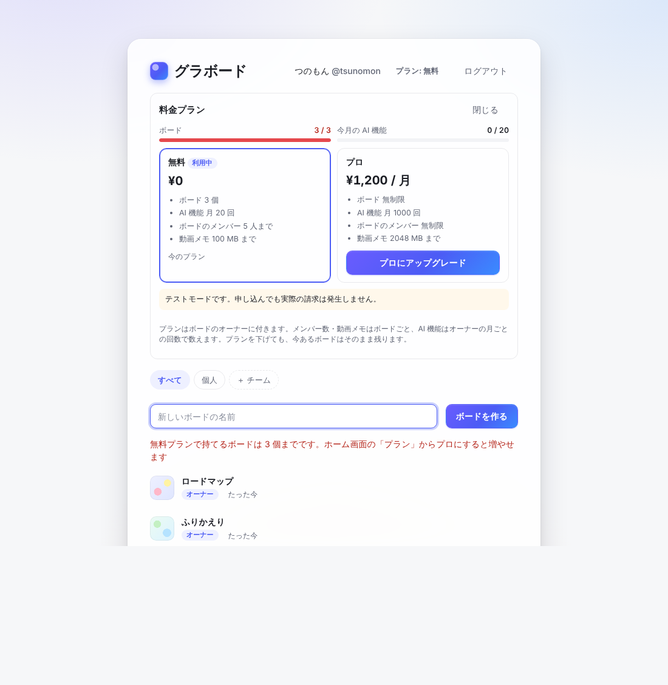
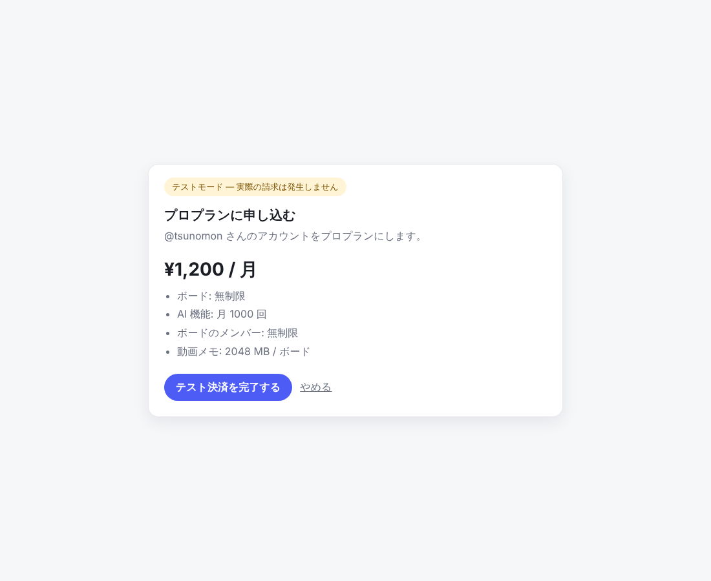

# 料金プランと支払い(Stripe)

グラボードには **無料** と **プロ** の 2 つのプランがあり、プランごとにボード数などの上限を決められます。
支払いは [Stripe](https://stripe.com/jp) の Checkout(申し込み画面)とカスタマーポータル(支払い方法の変更・領収書・解約)を使います。

**既定では料金プランは使いません**(全員が上限なし。今までどおりのセルフホスト)。サービスとして公開するときだけ有効にします。



## 3 つの動き方

| 設定 | 動き |
| --- | --- |
| 何も設定しない | **off**: 料金プランを使わない。ホーム画面に「プラン」は出ない |
| `BILLING=mock` | **テストモード**: Stripe の代わりにこのサーバーの「テスト決済」画面を出す。キーなしで画面と上限の動きを確かめられる(本番では使わない) |
| `STRIPE_SECRET_KEY`・`STRIPE_WEBHOOK_SECRET`・`STRIPE_PRICE_PRO` | **Stripe**: 本当に支払う(テスト用キー `sk_test_...` なら Stripe のテスト環境) |

`BILLING=off` にすると、Stripe のキーがあっても使いません。

## 上限

| | 無料(既定) | プロ(既定) | 環境変数 |
| --- | --- | --- | --- |
| 自分が持てるボード | 3 個 | 無制限 | `FREE_BOARDS` / `PRO_BOARDS` |
| AI 機能(要約・図の生成・議事録など) | 月 20 回 | 月 1000 回 | `FREE_AI_PER_MONTH` / `PRO_AI_PER_MONTH` |
| 1 つのボードに招待できるメンバー | 5 人 | 無制限 | `FREE_MEMBERS_PER_BOARD` / `PRO_MEMBERS_PER_BOARD` |
| 1 つのボードの動画メモの合計 | 100 MB | 2048 MB | `FREE_MEDIA_MB_PER_BOARD` / `PRO_MEDIA_MB_PER_BOARD` |

- `0` は無制限。料金画面に出す値段は `PRO_PRICE_LABEL`(既定 `¥1,200 / 月`)。実際の金額は Stripe の価格で決まるので、合わせておく。
- プランは **ボードのオーナー** に付きます。メンバー数と動画メモはボードごと、AI 機能はボードのオーナーの月ごとの回数(UTC の暦月)で数えます。オーナーのいないボード(ログインせずに作ったもの)で AI 機能を使うときはログインが必要で、使った人の回数になります。
- 上限に達すると API は `402 Payment Required` と理由を返し、画面には「ホーム画面の『プラン』からプロにすると増やせます」と出ます。
- プランを下げても、すでにあるボードやメンバーはそのまま残ります(新しく増やせなくなるだけ)。
- サーバー全体の上限(`MAX_USERS`・`MAX_BOARDS_PER_USER` など、[self-hosting.md](self-hosting.md#公開前の守り))はプランと別に、常に効きます。

## テストモードで試す

```sh
BILLING=mock cargo run -p board-server
```

ログインしてホーム画面の「プラン」→「プロにアップグレード」を押すと、テスト決済の画面に移ります。
「テスト決済を完了する」でプロになり、「お支払いの管理」→「解約して無料プランに戻す」で無料に戻ります。



## Stripe の設定

1. **商品と価格を作る**: Stripe のダッシュボードで「商品カタログ」→ 商品を追加(例「グラボード プロ」)→ 継続(月額 1,200 円など)の価格を作り、価格 ID(`price_...`)を控える。
2. **API キー**: 「開発者」→「API キー」のシークレットキー(`sk_test_...` / `sk_live_...`)。
3. **Webhook**: 「開発者」→「Webhook」→ エンドポイントを追加。
   - URL: `https://board.example.com/api/billing/webhook`
   - イベント: `checkout.session.completed`、`customer.subscription.created`、`customer.subscription.updated`、`customer.subscription.deleted`
   - 署名シークレット(`whsec_...`)を控える。
4. **カスタマーポータル**: 「設定」→「Billing」→「カスタマーポータル」を有効にする(支払い方法の変更・解約を許可)。
5. サーバーに設定して起動する。

```sh
STRIPE_SECRET_KEY=sk_test_...
STRIPE_WEBHOOK_SECRET=whsec_...
STRIPE_PRICE_PRO=price_...
PUBLIC_URL=https://board.example.com   # 決済のあとに戻る先(なければリクエストのホストから作る)
PRO_PRICE_LABEL='¥1,200 / 月'
```

手元で試すときは [Stripe CLI](https://docs.stripe.com/stripe-cli) で Webhook を転送できます。表示される `whsec_...` を `STRIPE_WEBHOOK_SECRET` に使います。

```sh
stripe listen --forward-to localhost:8080/api/billing/webhook
```

テスト用のカード番号は `4242 4242 4242 4242`(有効期限は未来の日付、CVC は任意)。

## しくみ

- 「プロにアップグレード」でサーバーが Checkout セッション(`mode=subscription`)を作り、その URL へ移ります。
  ログイン名を `client_reference_id` とサブスクリプションのメタデータ(`login`)に入れます。
- プランの切り替えは **Webhook だけ** で行います(戻ってきた URL では切り替えない)。署名(`Stripe-Signature`、HMAC-SHA256、時刻のずれ 5 分まで)を確かめ、同じイベント ID は一度だけ処理します。
- サブスクリプションが `active`・`trialing`・`past_due` の間はプロ、それ以外(`canceled`・`unpaid` など)は無料。`past_due` の間は画面に支払い方法の更新を促します。
- 期間の終わりで解約する予定なら、画面にその日付を出します。
- プランの変更は操作ログ(`billing.plan`)に残ります。
- 保存先: `billing`(ログイン名 → 契約)・`billing_customers`(Stripe の顧客 ID → ログイン名)・`billing_events`(処理済みのイベント)・`usage`(月ごとの AI の回数)。

## API

| メソッド | パス | 内容 |
| --- | --- | --- |
| `GET` | `/api/billing` | 自分のプラン・上限・今月の利用状況・選べるプラン |
| `POST` | `/api/billing/checkout` | 申し込みの画面の URL(`{ "url": ... }`) |
| `POST` | `/api/billing/portal` | 支払いの管理の画面の URL |
| `POST` | `/api/billing/webhook` | Stripe からの通知 |
