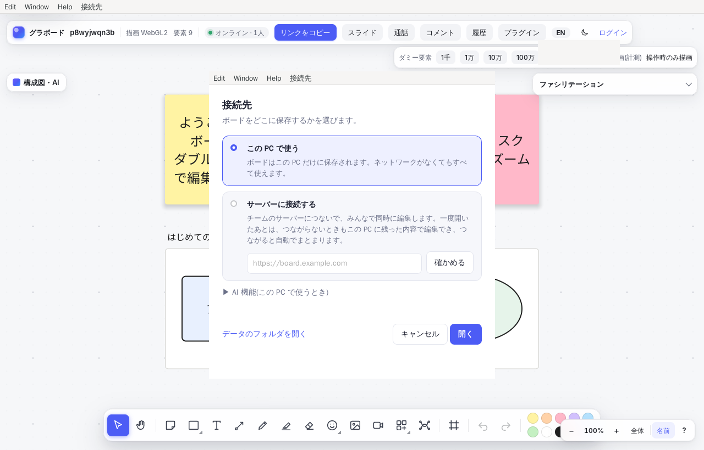
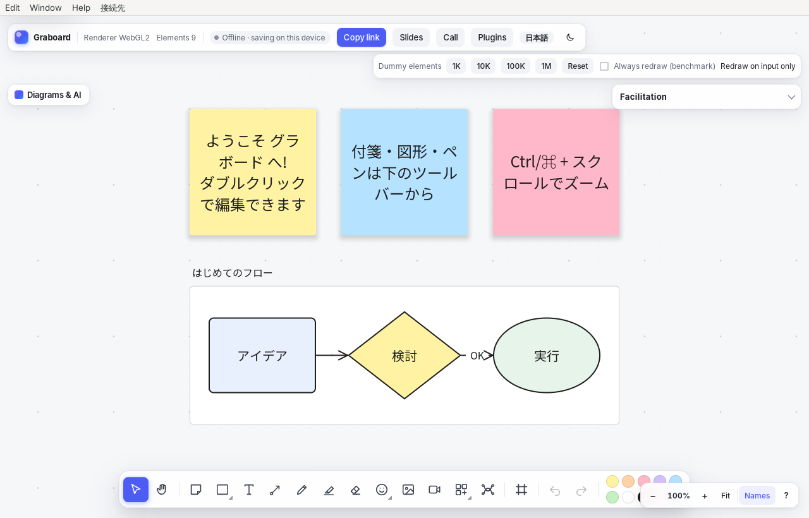

# デスクトップアプリ(Windows・macOS・Linux)

グラボードを [Tauri](https://tauri.app/) で包んだデスクトップアプリ。コードは `crates/board-desktop`。

- **この PC で使う**(既定): アプリの中で同期サーバー(`board-server`)を動かし、ボードとアカウントをこの PC に保存する。
  Web クライアントはアプリに埋め込んであるので、**ネットワークがなくても全部の画面と機能が使える**(AI・Slack・課題カードなど外部のサービスを使うものを除く)。
- **サーバーに接続する**: チームのサーバー(セルフホストした `board-server`)の URL を開いて、ほかの人と同時に編集する。
  Web 版と同じくボードは端末にも保存され、アプリ本体も端末に残るので、**一度開いたサーバーはつながらないときも前回のボードを開いて編集でき、つながると自動でまとまる**。



*サーバーを止めた状態でアプリを起動したところ。前回のボードがそのまま開き、「オフライン · この端末に保存」と出ている。*



## 使い方

| 操作 | 内容 |
| --- | --- |
| メニュー「接続先」→「この PC で使う(オフライン)」 | 内蔵サーバーのボードに切り替える |
| メニュー「接続先」→「サーバーに接続…」(`Ctrl/⌘ + Shift + K`) | 接続先の画面を開く。URL を入れて「確かめる」でつながるか試せる |
| メニュー「接続先」→「再読み込み」(`Ctrl/⌘ + R`) | ページを読み込み直す |
| メニュー「接続先」→「データのフォルダを開く」 | 内蔵サーバーの保存先(`boards.redb`)をファイルマネージャーで開く |

- 起動すると、接続先ごとに**最後に開いていたボード**から開く。
- ボードの外へのリンク(課題カード、ヘルプ、`target=_blank` のリンク)は既定のブラウザで開く。
- 2 つ目を起動しようとすると、今のウィンドウが前に出る(保存先のファイルは 1 つのアプリしか開けないため)。
- 内蔵サーバーは `127.0.0.1` だけで待ち受けるので、ほかの PC からはつながらない。みんなで使うときはサーバーに接続する。
- 内蔵サーバーで AI 機能を使うときは、接続先の画面の「AI 機能」に Anthropic の API キーを入れる(設定ファイルに保存され、すぐに有効になる)。
  環境変数 `ANTHROPIC_API_KEY` があればそれも使える。

### 保存場所

| もの | Windows | macOS | Linux |
| --- | --- | --- | --- |
| ボード(`boards.redb`) | `%APPDATA%\app.graboard.desktop\` | `~/Library/Application Support/app.graboard.desktop/` | `~/.local/share/app.graboard.desktop/` |
| 設定(`settings.json`) | `%APPDATA%\app.graboard.desktop\` | `~/Library/Application Support/app.graboard.desktop/` | `~/.config/app.graboard.desktop/` |

`boards.redb` はサーバー版と同じ形式なので、コピーすればサーバーの `DATA_DIR` にそのまま移せる(逆も同じ)。
バックアップはアプリを閉じてからこのファイルをコピーする。

### しくみ

```
┌─────────────── グラボード.app / .exe ───────────────┐
│  WebView(WebView2 / WKWebView / WebKitGTK)          │
│     └─ http://127.0.0.1:47180/  ← 埋め込みの Web クライアント │
│  board-server(axum + redb、アプリと同じプロセス)        │
└──────────────────────────────────────────────────────┘
```

- 内蔵サーバーは毎回 `127.0.0.1:47180` で開く(使われていれば空いているポートにして覚えておく)。ページのオリジンが変わらないので、ログイン状態や端末内の保存が引き継がれる。
- サーバーに接続するときは、そのサーバーの URL をそのまま WebView で開く(ログインの Cookie や SSO もブラウザと同じように動く)。
  起動時にサーバーへつながるかを確かめ、つながらなければ、一度開いたことのあるサーバーならそのまま開き(Service Worker と IndexedDB に残った内容で動く)、初めてのサーバーなら内蔵サーバーのボードを開く。
- WebView に開いたページには Tauri の API を渡さない(`capabilities/default.json` で、アプリに同梱した接続先の画面だけに許している)。

## ビルド

必要なもの: Rust(1.88 以上)、[trunk](https://trunkrs.dev/)、[Tauri CLI](https://v2.tauri.app/reference/cli/)(`cargo install tauri-cli --version "^2" --locked`)と、OS ごとの準備([Tauri の前提条件](https://v2.tauri.app/start/prerequisites/)):

- **Windows**: Microsoft C++ Build Tools と WebView2(Windows 10 / 11 は入っている)
- **macOS**: Xcode Command Line Tools(`xcode-select --install`)
- **Linux**: `sudo apt install libwebkit2gtk-4.1-dev libgtk-3-dev libayatana-appindicator3-dev librsvg2-dev libxdo-dev libssl-dev`

```sh
# 1. Web クライアントをビルド(アプリに埋め込む)
(cd crates/board-web && trunk build --release)

# 2. アプリを作る
cd crates/board-desktop
cargo tauri build          # インストーラー: target/release/bundle/ の下
# 開発中にそのまま起動するだけなら
cargo run
```

`cargo tauri build` が作るもの:

| OS | 作られるもの |
| --- | --- |
| Windows | `bundle/nsis/グラボード_0.1.0_x64-setup.exe`、`bundle/msi/グラボード_0.1.0_x64_ja-JP.msi` |
| macOS | `bundle/macos/グラボード.app`、`bundle/dmg/グラボード_0.1.0_aarch64.dmg` |
| Linux | `bundle/deb/…_amd64.deb`、`bundle/appimage/…_amd64.AppImage` |

それぞれの OS の上でビルドする(Tauri は別の OS 向けのインストーラーを作れない)。
Mac で Intel と Apple シリコンの両方で動かすには `cargo tauri build --target universal-apple-darwin`(先に `rustup target add x86_64-apple-darwin aarch64-apple-darwin`)。

### 署名

署名しないインストーラーは、Windows では SmartScreen の警告、macOS では「開発元を確認できません」が出る(右クリック →「開く」で起動できる)。
配るときは署名する:

- **macOS**: Apple Developer の証明書で署名して公証する。環境変数 `APPLE_SIGNING_IDENTITY`、`APPLE_ID`・`APPLE_PASSWORD`・`APPLE_TEAM_ID` を設定して `cargo tauri build`。
  マイク・カメラ(音声通話・動画メモ)の許可は `Info.plist` と `Entitlements.plist` に入れてある。
- **Windows**: コード署名証明書を `tauri.conf.json` の `bundle.windows.certificateThumbprint` に指定する(詳しくは [Tauri のドキュメント](https://v2.tauri.app/distribute/sign/windows/))。

### アイコン

`icons/` はアプリロゴ(`tools/brand/render-icons.js` で作る)から生成したもの。ロゴを変えたらそのスクリプトで作り直すか、1024×1024 の PNG を用意して `cargo tauri icon 画像.png` を実行する。

## できないこと・注意

- 内蔵サーバーのボードとサーバーのボードは別のもの(自動では行き来しない)。サーバーに移したいボードは、書き出し・取り込みか `boards.redb` のコピーで移す。
- 自動アップデートはまだない。新しい版はインストーラーを入れ直す(ボードと設定は残る)。
- macOS の WKWebView はブラウザ版の Safari と同じく WebGPU に対応していない版があり、そのときは WebGL2 で描く。
